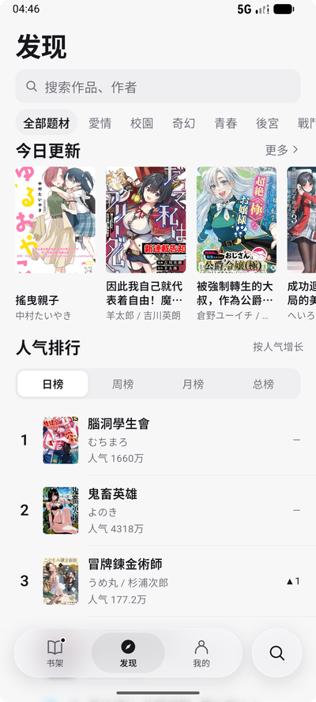
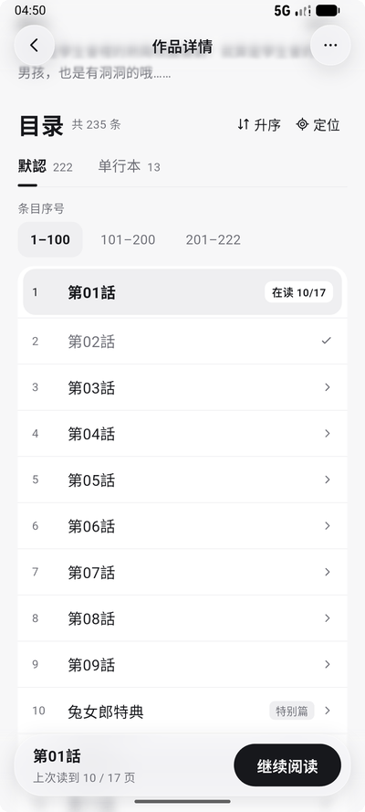
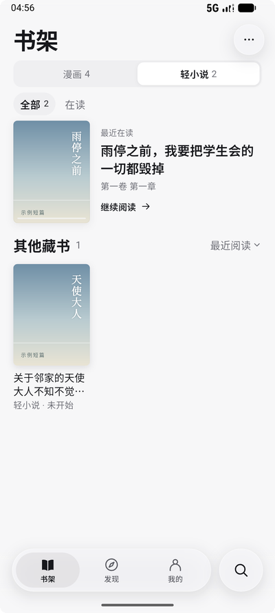

<div align="center">
  <a href="https://github.com/luminacry/-kan-JIAN">
    
  </a>
  <h2 align="center">栞间</h2>
  <p>漫画与轻小说的第三方阅读器，单色界面，Android / iOS</p>
</div>

<p align="center">
  <a href="https://github.com/luminacry/-kan-JIAN/releases/latest"></a>
  
  
  
  
  
</p>

<table>
  <tr>
    <td align="center" width="20%"></td>
    <td align="center" width="20%"></td>
    <td align="center" width="20%"></td>
    <td align="center" width="20%"></td>
    <td align="center" width="20%"></td>
  </tr>
  <tr>
    <td align="center"><sub>书架</sub></td>
    <td align="center"><sub>发现</sub></td>
    <td align="center"><sub>作品详情</sub></td>
    <td align="center"><sub>漫画阅读器</sub></td>
    <td align="center"><sub>轻小说</sub></td>
  </tr>
</table>

## 功能

- **书架**：继续阅读、更新提醒，按连载状态筛选，按阅读或更新时间排序
- **发现**：题材筛选、今日更新、日 / 周 / 月 / 总排行
- **搜索**：作品名与作者一起搜、关键词高亮，可切到轻小说搜索
- **作品详情**：多分组章节、按百话分段，一键回到在读那一话
- **漫画阅读器**：单页 / 条漫、左右翻页方向、双击缩放、省流画质、页面亮度，话末接下一话
- **轻小说**：接入 Wenku8，登录与书架同步、分卷目录、正文带插图、左右翻页或整章滚动、书签
- **滚动边缘模糊**：顶部状态栏与底部胶囊上方渐变过渡，跟随系统「减少透明度」自动降级
- **线路自动选择**：多条源站线路启动测速、断线自动切换，可固定线路或填自建中转
- **应用内更新**：检查本仓库 Releases，应用内下载安装，支持镜像加速

反馈请加 Q 群：`1104352977`

## 下载

到 [Releases](https://github.com/luminacry/-kan-JIAN/releases) 下载：

| 文件 | 说明 |
| --- | --- |
| `kanjian-X.Y.Z.apk` | 通用包，任何机型都能装 |
| `kanjian-X.Y.Z-arm64-v8a.apk` | 近年手机，体积最小 |
| `kanjian-X.Y.Z-armeabi-v7a.apk` | 老机型 |
| `kanjian-X.Y.Z-x86_64.apk` | 模拟器 |
| `kanjian-vX.Y.Z-unsigned.ipa` | iOS 26+，需自行签名 |

- Android 7.0 及以上；装了架构包之后要一直装同架构的包（通用包版本号更小，混装会被判为降级）。
- iOS 安装包未签名，用 Sideloadly、AltStore 等以自己的 Apple ID 签名安装；由 CI 构建后附到 Release。
- 每个 Release 附 `checksums.txt`，可核对安装包 SHA-256。

## 构建

需要 Flutter 3.47 及以上。

```bash
flutter pub get
flutter run
flutter test
flutter build apk --release                    # 通用包
flutter build apk --release --split-per-abi    # 按架构拆分
```

正式版签名读 `android/key.properties`（不在仓库里），缺失时用 debug 签名。

在模拟器里调试（AVD + `flutter run`，参数见脚本头部）：

```powershell
powershell -ExecutionPolicy Bypass -File tool\run_avd.ps1
```

iOS 包由 GitHub Actions 在 macOS 上构建（`.github/workflows/ios-ipa.yml`），也可本机 `flutter build ios --release --no-codesign`。

发新版本：改 `pubspec.yaml` 的 `version`，建 `vX.Y.Z` 的 Release 并附上 APK，工作流会把 IPA 附到同一个 Release。

## 声明

栞间只是阅读器：不内置账号，不绕过付费与会员限制，不提供批量下载。作品内容实时来自第三方源站，版权归原作者及权利人所有。本项目为 [Apache-2.0](LICENSE)。
